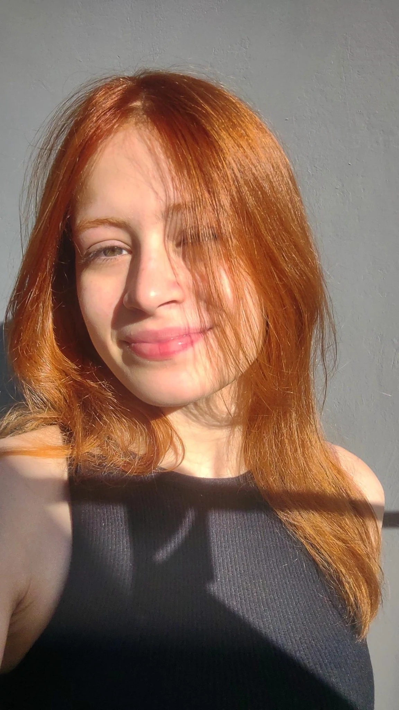

# 🪎 Portfólio — Sofia Oliveira Gonçalves

Site estático responsivo para apresentar desenvolvimento Full Stack, Lookdev 3D, formação e contatos.

## 🖱️ Como executar

1. Copie o link do repositório.
2. Clone no terminal de preferência, para o explorer.
3. Abra a pasta no Visual Studio Code.
4. Abra `index.html` no navegador ou use a extensão **Live Server** do VS Code.
5. A página não precisa de Python, Java ou servidor de banco de dados para funcionar. A interação é feita com JavaScript no navegador.

O efeito de rolagem suave usa a biblioteca Lenis pelo CDN jsDelivr. Se a biblioteca ou a conexão externa não estiver disponível, o site continua navegável com a rolagem nativa do navegador. As fontes são carregadas pelo Google Fonts; fontes de sistema são usadas como alternativa.

## 👩🏻‍🏫 Autor
<div>
  <table>
  <tr>
  <td align="center" width="180">
        
        <br><br>
        <strong>Sofia Oliveira Gonçalves</strong>
        <br>
        <sub>Idade: 22 anos.</sub>
        <br>
        <sub>Região: São Paulo, Brasil.</sub>
        <br>
        <sub>Curso concluído: Animação 3D, pela Faculdade de tecnologia Méliès.</sub>
        <br>
        <sub>Cursando, término (08-2028): Análise e desenvolvimento de sistemas na FIAP (faculdade de informática e administração paulista).</sub>
        <br>
        <sub></sub>
        <br>
        <sub></sub>
        <br><br>
        <a href="https://www.linkedin.com/in/sofia-goncalves-272472431/">LinkedIn</a>
        ·
        <a href="https://github.com/sofiaolivagoliva">GitHub</a>
        .
        <a href="https://www.instagram.com/sofia_goliva/?hl=pt-br">Instagram</a>
        .
        <a href="https://open.spotify.com/playlist/0GAoxKPI9WdYt6ZKD1L1VH?si=z8BPd3W5SVSDMD-JVwTX8g">Spotify</a>
    </td>
  </tr>
   </table>
</div>

## 🗃️ Estrutura

```text
Portifólio/
├── index.html
├── README.md
├── css/
│   └── style.css
├── js/
│   └── main.js
└── assets/
    ├── images/
    │   ├── sofia.webp
    │   ├── haka-chatbot.jpg
        ├── haka-chatbot.jpg
│       │
│       ├── Projeto Angelina Jolie.png
│       ├── Projeto Angelina Jolie(2).png
│       ├── Projeto Angelina Jolie(3).png
│       │
│       ├── Projeto Naja.png
│       ├── Projeto Naja (2).png
│       ├── Projeto Naja (3).png
│       └── Projeto Naja (4).png
    └── certificates/
        ├── diploma-design-animacao-redigido.jpg
        ├── nano-programacao-web.png
        └── nano-formacao-social-sustentabilidade.png
    └──  lookdev
        └── .gitkeep
```

## 🛠️ Tecnologias
- HTML
- CSS
- JavaScript
- Desenvolvidos no VS Code

## 🚀 Interações incluídas

- Rolagem suave com Lenis e alternativa nativa.
- Destaques de entrada ativados conforme a rolagem.
- Iluminação de fundo e cursor personalizado em dispositivos com mouse.
- Movimento sutil da foto e inclinação dos cartões de projeto ao mover o cursor.
- Barra de progresso total e marcador de seção no formato `01 / 06`.
- Menu adaptado a telas pequenas.
- Filtros de projetos por Front-end, Banco de Dados, Python, Java e IA.
- Galeria horizontal de Lookdev com arraste no desktop e gesto lateral no celular.
- Ampliação dos certificados em uma janela acessível por teclado.
- Respeito à preferência do sistema por movimento reduzido.

## 🎨 Personalização visual

A identidade visual foi decidida para se tortar uma característa minha para padronizar as demais redes sociais, como apresentação do GitHub, instagram e outros. Dentro de `:root`. A paleta usa fundo ameixa escuro, lavanda e amarelo pastel, com contraste pensado para leitura e pelo amor às cores.

## 🧐 Observações

- Os três espaços de Lookdev são renders finais.
- O que é Lookdev? Look Development é o processo que incluí, Modelagens 3D, Texturização, Iluminação, Posicionamento, Renderização e Pós produção completos de uma ou mais cenas.
- O link do lookdev é direcionado à um curta metragem do YouTube, chamado "Coffee break". O lookdev completo da cidade e parte do Lookdev do escritório foi realizada por mim. Este projeto foi elaborado em equipe, sendo trabalhado o 3D com integração em 2D.
- O site não inventa experiências profissionais. A apresentação destaca a formação em Design de Animação, os estudos atuais em ADS e os projetos desenvolvidos. Logo haverão mais projetos e certificados..